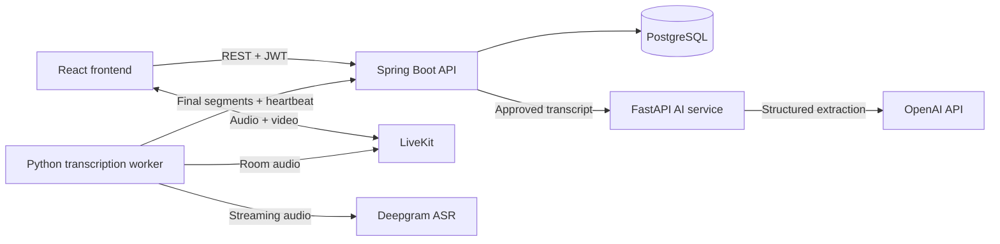

# Telehealth AI Platform

[](https://github.com/yasinttunc/telehealth-ai-platform/actions/workflows/ci.yml)

A full-stack telehealth application that brings appointment management, secure
video consultations, live transcription, structured symptom extraction,
clinician review, and explainable clinic alerts into one workflow.

> **Portfolio demonstration only.** The repository uses synthetic data. It is
> not a medical device, does not provide a diagnosis, and must not be used for
> real clinical decisions.

## Product Highlights

- Role-based workspaces for administrators, clinicians, and patients.
- JWT authentication with BCrypt password storage and server-side ownership checks.
- Consultation scheduling, waiting rooms, and two-party video calls.
- LiveKit room tokens issued by the backend, keeping secrets out of the browser.
- Deepgram live transcription with immutable final transcript segments.
- Schema-constrained OpenAI symptom extraction from approved transcripts.
- Separate clinician approval for transcript text and extracted findings.
- Deterministic clinic alert detection with evidence and status history.
- Responsive React interface backed by a Spring Boot REST API.

## Architecture



The backend is the system boundary. Browsers never receive database, OpenAI,
Deepgram, or LiveKit server credentials. The transcription worker uses a
separate internal service key when sending transcript segments to Spring.

## Technology Stack

| Area | Technology |
|---|---|
| Frontend | React 19, TypeScript, Vite, Tailwind CSS, Lucide |
| Backend | Java 21, Spring Boot, Spring Security, Spring Data JPA |
| Database | PostgreSQL and Docker Compose |
| Authentication | BCrypt and signed JWTs |
| AI service | Python, FastAPI, Pydantic, OpenAI SDK |
| Video | LiveKit |
| Transcription | Deepgram streaming ASR |
| Testing | JUnit, Spring test support, pytest, TypeScript build, Oxlint |

## Repository Structure

```text
telehealth-ai-platform/
|-- src/                    Spring Boot application and Java tests
|-- frontend/               React and TypeScript user interface
|-- ai-service/             FastAPI extraction service and ASR worker
|-- infra/postgres/         Database image, schema, seed, and migrations
|-- scripts/                Local startup helpers
|-- .env.example            Backend and infrastructure configuration
|-- docker-compose.yml      Local PostgreSQL service
|-- apply-migrations.sh     Existing-volume migration helper
|-- pom.xml                 Maven project configuration
`-- README.md               Setup and architecture guide
```

Only the runnable product source, infrastructure, and application tests are
included. Generated reports and unrelated working files stay outside the repo.

## Core Workflow

### Consultation and transcription

1. An administrator or clinician schedules a consultation for a patient.
2. The assigned clinician and patient enter a role-aware waiting room.
3. Spring verifies access and creates a short-lived LiveKit room token.
4. LiveKit carries audio and video between participants.
5. A Python worker sends room audio to Deepgram.
6. Interim captions remain temporary UI state.
7. Final transcript segments are stored through authenticated internal routes.
8. The clinician can correct the assembled transcript and approve a revision.

### Extraction and review

1. The clinician requests extraction from an approved transcript revision.
2. Spring creates an asynchronous job and calls the private FastAPI service.
3. OpenAI returns schema-constrained findings with assertion, confidence, and evidence.
4. Spring stores the output with model, prompt, and transcript provenance.
5. The clinician accepts or corrects the findings in a separate review step.
6. Only accepted `PRESENT` findings can contribute to clinic alerts.

The two approvals have different meanings. Transcript approval confirms that
the written conversation is accurate. Finding approval confirms that the
structured clinical interpretation is acceptable.

## Alert Detection

The alert detector is deterministic and explainable. It is not a diagnostic or
predictive model.

For each clinic and accepted symptom code, it counts distinct consultations in
a current seven-day window and in the previous 28 days. The previous period is
treated as four seven-day baseline periods.

```text
baseline average = baseline consultation count / 4
score = observed consultation count / max(baseline average, 1)
```

An alert is created when both rules are met:

```text
observed consultation count >= 3
score >= 2.50
```

The baseline floor avoids division by zero. A database uniqueness rule prevents
duplicate alerts for the same clinic, symptom, time window, and detector
version. Each alert stores evidence snapshots and a status history so the UI
can explain why it exists and how it was handled.

## Prerequisites

- Java 21 or later
- Docker Desktop with Docker Compose
- Node.js 22 or later and npm
- Python 3.9 or later
- OpenAI credentials for live symptom extraction
- LiveKit and Deepgram credentials for live video transcription

The Maven wrapper is included, so a separate Maven installation is not needed.

## Quick Start

Use separate terminals for PostgreSQL, FastAPI, Spring Boot, and the frontend.

### 1. Configure local environment files

```bash
cp .env.example .env
cp ai-service/.env.example ai-service/.env
cp frontend/.env.example frontend/.env.local
```

Generate private local values for `JWT_SECRET` and `INTERNAL_SERVICE_KEY`.
`INTERNAL_SERVICE_KEY` must have the same value in the root and AI service
files. Never commit any `.env` file.

For a demonstration without paid AI calls, set this in the root `.env`:

```dotenv
AI_PROVIDER=mock
```

For the FastAPI and OpenAI path, use:

```dotenv
AI_PROVIDER=python
AI_SERVICE_URL=http://127.0.0.1:8001
```

Then set `OPENAI_API_KEY` and an available `OPENAI_MODEL` in
`ai-service/.env`. LiveKit and Deepgram settings can remain empty until the
live call workflow is needed.

### 2. Start PostgreSQL

```bash
docker compose up -d --build
docker compose ps
```

The database is exposed on `localhost:55432`. A new Docker volume runs every
file under `infra/postgres/init/` automatically. For an existing database
volume, apply the idempotent migrations:

```bash
./apply-migrations.sh
```

### 3. Start the AI service

This step is optional when Spring uses `AI_PROVIDER=mock`.

```bash
cd ai-service
python3 -m venv .venv
source .venv/bin/activate
python -m pip install --upgrade pip
python -m pip install -r requirements.txt
python -m fastapi dev app/main.py --port 8001
```

Health check:

```bash
curl http://127.0.0.1:8001/health
```

Expected response:

```json
{"status":"ok"}
```

### 4. Start Spring Boot

From the repository root:

```bash
./scripts/run-spring-local.sh
```

The API starts on `http://localhost:8091`. Spring validates the database schema
at startup. If an older volume is missing a migration, run
`./apply-migrations.sh` and restart Spring.

### 5. Start the frontend

```bash
cd frontend
npm ci
npm run dev
```

Open [http://localhost:5173](http://localhost:5173). Vite proxies `/api` to
Spring on port `8091`.

## Demo Accounts

The PostgreSQL seed provides local demonstration accounts:

| Role | Username | Password |
|---|---|---|
| Administrator | `admin` | `admin` |
| Clinician | `dr.sarah.patel` | `password` |
| Patient | `patient.oliver.hughes` | `password` |

These deliberately simple credentials are for an isolated local environment
only. Do not reuse them in a deployed system.

## Configuration

### Root `.env`

| Variable | Purpose | Local default/example |
|---|---|---|
| `POSTGRES_DB` | Database name | `telehealth` |
| `POSTGRES_USER` | Database user | `telehealth` |
| `POSTGRES_PASSWORD` | Database password | local value |
| `DB_URL` | Spring JDBC URL | `jdbc:postgresql://localhost:55432/telehealth` |
| `DB_USERNAME` | Spring database user | `telehealth` |
| `DB_PASSWORD` | Spring database password | local value |
| `SERVER_PORT` | Spring HTTP port | `8091` |
| `FRONTEND_ORIGIN` | Allowed browser origin | `http://localhost:5173` |
| `JWT_SECRET` | HMAC signing secret | at least 32 random characters |
| `JWT_EXPIRATION_MS` | Token lifetime | `3600000` |
| `AI_PROVIDER` | Spring extraction adapter | `mock` or `python` |
| `AI_SERVICE_URL` | FastAPI base URL | `http://127.0.0.1:8001` |
| `AI_TIMEOUT_SECONDS` | AI request timeout | `45` |
| `AI_PROMPT_VERSION` | Stored extraction provenance | `symptom-extraction-v1` |
| `INTERNAL_SERVICE_KEY` | Worker-to-Spring authentication | shared private value |
| `LIVEKIT_URL` | Public LiveKit WebSocket URL | provider value |
| `LIVEKIT_API_KEY` | Server-side LiveKit key | provider value |
| `LIVEKIT_API_SECRET` | Server-side LiveKit secret | provider value |
| `TRANSCRIPTION_WORKER_ENABLED` | Automatic worker launch | `true` |

### `ai-service/.env`

| Variable | Purpose |
|---|---|
| `OPENAI_API_KEY` | Server-side extraction credential |
| `OPENAI_MODEL` | Exact model identifier available to the account |
| `OPENAI_TIMEOUT_SECONDS` | Provider timeout |
| `PROMPT_VERSION` | Stored prompt provenance |
| `DEEPGRAM_API_KEY` | Streaming transcription credential |
| `SPRING_INTERNAL_BASE_URL` | Spring address used by the worker |
| `INTERNAL_SERVICE_KEY` | Must match the root value |
| `DEEPGRAM_MODEL` | Streaming ASR model |
| `DEEPGRAM_LANGUAGE` | Recognition language |
| `DEEPGRAM_SAMPLE_RATE` | PCM sample rate |
| `DEEPGRAM_ENCODING` | Audio encoding |

## API Documentation

The Spring Boot backend publishes its browser-facing REST contract as an OpenAPI 3 specification. Swagger UI is generated from the running application, so its request models, response schemas, validation constraints, and endpoint groups remain aligned with the implementation.

| Resource | Local address | Purpose |
| --- | --- | --- |
| Swagger UI | [http://localhost:8091/swagger-ui.html](http://localhost:8091/swagger-ui.html) | Explore and exercise the browser-facing REST API interactively. |
| OpenAPI JSON | [http://localhost:8091/v3/api-docs](http://localhost:8091/v3/api-docs) | Consume the machine-readable OpenAPI specification. |
| AI-service schema | [http://127.0.0.1:8001/docs](http://127.0.0.1:8001/docs) | Inspect the separate FastAPI extraction-service boundary when that service is running. |

Start the Spring application before opening the first two links. These are local development endpoints, not a publicly hosted API.

### Authenticating in Swagger UI

Most application endpoints require a JWT. Call `POST /api/auth/login` with one of the local demonstration accounts, copy the returned token, select **Authorize** in Swagger UI, and paste the token into the `bearerAuth` security scheme. The login operation is intentionally public; protected operations then execute with the supplied token.

### Browser-facing API surface

Only `/api/**` routes appear in the Spring OpenAPI specification. Spring Security and service-level ownership checks enforce role access.

| Area | Base route | Main operations |
|---|---|---|
| Authentication | `/api/auth` | Login and JWT issuance |
| Users | `/api/users` | User management and password reset |
| Clinics | `/api/clinics` | Clinic management |
| Doctors | `/api/doctors` | Clinician profiles and specialty lookup |
| Patients | `/api/patients` | Patient profiles and NHS-number lookup |
| Consultations | `/api/consultations` | Scheduling, status, transcript, approval |
| Video token | `/api/consultations/{id}/livekit-token` | Role-bound room token |
| Extraction jobs | `/api/consultations/{id}/extraction-jobs` | Create and inspect jobs |
| Finding review | `/api/symptom-records/{id}/review` | Read and save accepted findings |
| Alerts | `/api/alerts` | List, evidence, history, and status changes |

Internal worker routes under `/internal/**` require `INTERNAL_SERVICE_KEY` and are intentionally excluded from the browser-facing OpenAPI contract.

## Testing

### Spring Boot

```bash
./mvnw -q test
```

The Java suite covers authentication, authorisation, ownership rules,
consultation state transitions, transcript approval, extraction jobs, finding
review, alert thresholds, time boundaries, and duplicate prevention.

### Frontend

```bash
cd frontend
npm ci
npm run lint
npm run build
```

The build runs TypeScript checks before generating the production Vite bundle.

### AI service and transcription worker

```bash
cd ai-service
source .venv/bin/activate
python -m pytest -q
```

Unit tests do not make paid API calls. Tests under `tests/live/` remain skipped
unless the required credentials, services, and explicit live-test flags are
provided.

The optional integration runner reports local service availability before
starting the live suite:

```bash
cd ai-service
./run_integration_tests.sh
```

The live suite can call paid external services. Review its output and local
configuration before enabling it.

### Continuous integration

Every push and pull request runs three GitHub Actions jobs: the Spring Boot test
suite against PostgreSQL started from `docker-compose.yml` (schema and seed data
from `infra/postgres/init`), the AI service unit tests, and the frontend lint and
production build.

## Design Decisions

- **Server-owned security:** navigation guards improve user experience, but all
  authorisation decisions are repeated in Spring.
- **Asynchronous extraction:** long AI requests do not block the consultation
  page or hide job state from the user.
- **Immutable final segments:** the original transcription evidence remains
  available even after a clinician edits the canonical transcript.
- **Explicit provenance:** extraction records keep model, prompt, and transcript
  revision information.
- **Human review before alerts:** raw model output cannot directly change clinic
  alert counts.
- **Idempotent boundaries:** transcript segment keys and alert uniqueness rules
  make network retries safe.
- **Provider isolation:** external AI and transcription SDKs remain behind small
  Python adapters rather than leaking into the React or Java domain models.

## Troubleshooting

### Login fails

Confirm PostgreSQL and Spring are running, the frontend proxy targets port
`8091`, and the database was created from the current seed. A reused Docker
volume may contain older credentials.

### Spring reports a schema validation error

```bash
./apply-migrations.sh
```

Then restart Spring. New installations can instead recreate the local database
volume, but that deletes local records.

### Video is not configured

Set `LIVEKIT_URL`, `LIVEKIT_API_KEY`, and `LIVEKIT_API_SECRET` in the root
`.env`, then restart Spring. Live transcription also requires Deepgram and a
matching internal service key in `ai-service/.env`.

### Extraction returns HTTP 503

Confirm FastAPI is listening on port `8001`, Spring uses
`AI_PROVIDER=python`, `AI_SERVICE_URL` is correct, and the OpenAI key and model
are available. Provider keys must never be placed in frontend files.

### Stop local services

Stop the foreground development servers with `Ctrl+C`. Stop PostgreSQL without
deleting data:

```bash
docker compose down
```

## Security and Current Limitations

- All checked-in patient and consultation records are synthetic.
- Local seed passwords are intentionally weak and must be replaced for any
  deployed environment.
- Secrets belong only in ignored `.env` files or a deployment secret manager.
- Live captions are temporary; only final server-side segments form the stored
  transcript provenance.
- AI output is limited to structured symptom mentions and requires clinician
  review. It does not provide diagnoses or treatment advice.
- The alert thresholds are demonstration rules and have not been clinically
  validated.
- The application has not undergone medical-device, production-security, or
  accessibility certification.
- Do not enter real patient-identifiable information into this project.
